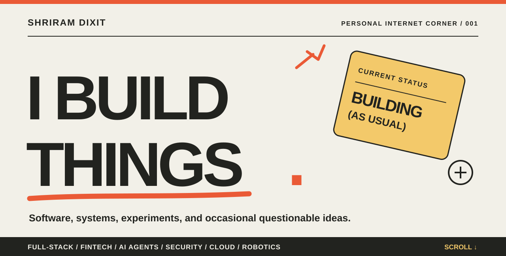
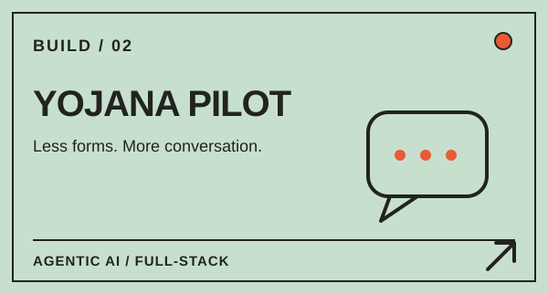
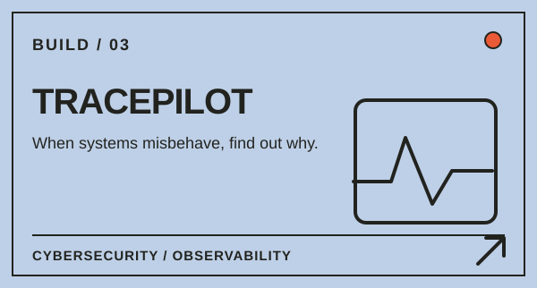
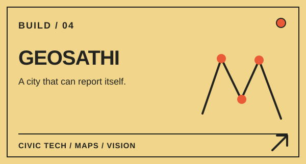
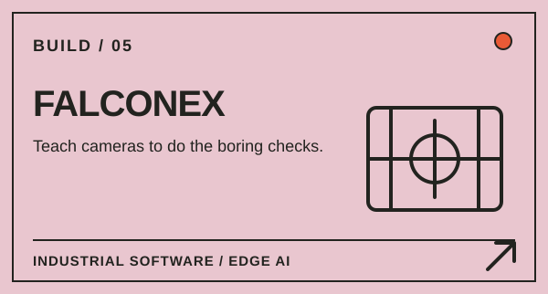
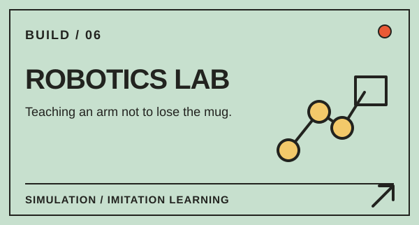
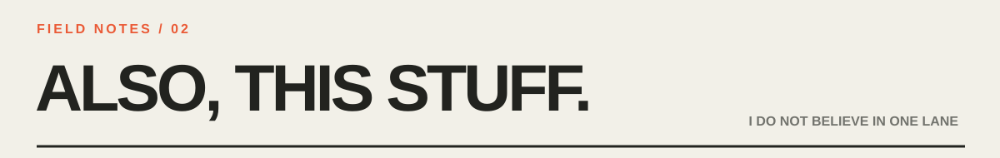
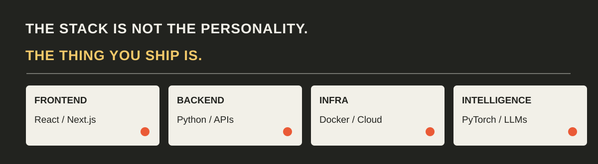
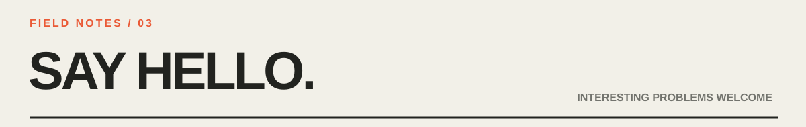

<<<<<<< HEAD
  

  <a href="https://github.com/ShrE333?tab=repositories">The code</a> &nbsp;·&nbsp;
  <a href="https://www.linkedin.com/in/shriram-dixit-9470a1285/">LinkedIn</a> &nbsp;·&nbsp;
  <a href="mailto:shdixit10@gmail.com">Say hello</a>

### hey, I'm Shriram. 👋

I write software, build systems, chase down weird bugs, and occasionally get very invested in making something work that probably shouldn't.

I've worked on everything from **payment infrastructure and cybersecurity tools** to **AI assistants, cloud applications, computer vision, and robots**. Some projects solve serious problems. Others start with *"wait, can we do that?"*

I like both kinds.

> **Give me a problem. I'll probably build something.**

 

<!-- The cards below are original SVG assets and work without JavaScript. -->
<table>
<tr>
<td width="50%" valign="top">
  
  
Programmable authorization and transaction safeguards for agent-driven commerce. <a href="https://github.com/ShrE333/IntentLock">Explore the repo →</a>

</td>
<td width="50%" valign="top">
  
  
A conversational guide to public schemes, designed around people rather than forms. <a href="https://github.com/ShrE333/Yojana-Pilot">Explore the repo →</a>

</td>
</tr>
<tr>
<td width="50%" valign="top">
  
  
Logs, anomaly detection, and a clearer path from system events to investigation. <a href="https://github.com/Omimore/cloud-based-anomoly-detection">Explore the repo →</a>

</td>
<td width="50%" valign="top">
  
  
Civic reporting across maps, imagery, and messaging interfaces. <a href="https://github.com/ShrE333/Fusion_2026">Explore the repo →</a>

</td>
</tr>
<tr>
<td width="50%" valign="top">
  
  
An industrial vision platform spanning model training, inference, cameras, and factory automation. <em>Private / proprietary work.</em>

</td>
<td width="50%" valign="top">
  
  
Robot learning, simulation, manipulation, and the surprisingly hard problem of trustworthy demonstrations. <em>Selected experiments.</em>

</td>
</tr>
</table>

 

A few things that don't fit neatly in one box:

- **I build products end to end.** UI, APIs, databases, auth, deployment, debugging, the unglamorous last 20%.
- **I like difficult infrastructure problems.** Cloud services, containers, distributed workflows, monitoring, and getting systems to cooperate.
- **I keep a foot in the physical world.** Edge AI, machine vision, robotics, automation, and systems that can't just be restarted when they fail.
- **I take research seriously.** Patent filings, published research, and turning experimental ideas into things people can actually use.

<strong>Okay, but what do you actually use? ↘</strong>

 

| The job | Tools I've worked with |
| :-- | :-- |
| Apps & interfaces | React, Next.js, Flutter, TypeScript, JavaScript |
| Backends & data | Python, FastAPI, Flask, PostgreSQL, MongoDB, Supabase |
| Infrastructure | Docker, GitHub Actions, Cloudflare Workers, GCP, Vercel, NVIDIA Triton |
| AI & computer vision | PyTorch, OpenCV, ONNX, YOLO, LLM APIs |
| Robotics & edge | NVIDIA Isaac Sim / Isaac Lab, Jetson, PLC integrations |

<strong>A few numbers with actual context ↘</strong>

 

- **60 workbenches / 3 plants:** industrial AI inference deployments described in my previous work.
- **90%:** reported reduction in quality-control cost for an automated visual-inspection application.
- **3 patent filings:** spanning industrial AI, multimodal vision, and assistive technology.
- **Research:** work presented/published at ICSIAIML 2025.

These are project-specific milestones, not generic performance claims for every product here.

 

I'm interested in projects at the intersection of **good software, hard problems, and actual users**. If you're building something ambitious, have an interesting engineering puzzle, or just want to compare notes:

**[Email me](mailto:shdixit10@gmail.com)** · **[Connect on LinkedIn](https://www.linkedin.com/in/shriram-dixit-9470a1285/)** · **[Browse everything I've built](https://github.com/ShrE333?tab=repositories)**

Built with plain Markdown and hand-drawn SVG. No badge wall. No fake terminal. No dependencies to install.
=======

# Shriram Dixit
### AI Systems Engineer · Edge AI · Computer Vision · Industrial Automation

---

### 👋 About Me

I'm a 3rd-year B.Tech AI/ML student at Vishwakarma University, Pune — building real industrial AI systems, not just college projects.

- 🏭 Deployed AI inference across **60 workbenches in 3 manufacturing plants** (Fleetguard / Cummins)
- 📉 Reduced Cost of Quality Control by **90%** via automated visual inspection
- 📜 **3 Patents Filed** — Industrial AI, RGB-IR Fusion, Sign Board Reader
- 📄 **Research Published** — ICSIAIML 2025
- 🚀 Founder building **Falconex** — an Industrial AI Vision platform

---

### 🛠️ Tech Stack

**AI / ML / CV**

**Edge AI & Deployment**

**Embedded & IoT**

---

### 🏆 Key Projects

| Project | Description | Status |
|--------|-------------|--------|
| 🔬 **Falconex AIVI** | Industrial AI platform — dual-server architecture, multi-camera inspection, PLC integration across 3 plants | 🔒 Proprietary · Patent Filed |
| 🤖 **Weld Inspection Gantry** | Robotic CV system for weld detection — TACO Gotion | ✅ Deployed |
| 🫁 **TB 3D Detection** | Deep learning pipeline converting 2D X-rays to 3D for TB diagnosis | [📂 View](https://github.com/ShrE333/Tuberculosis_3d_Detection) |
| 🤟 **Sign Sense AI** | Real-time sign language recognition using OpenCV + MediaPipe | 🔒 Proprietary |
| 🚁 **Autonomous Drone** | Multi-disciplinary drone with AI, IoT, CV & sensor fusion | ✅ Complete |
| 💳 **Shoonya** | AI-powered smart loan platform — Next.js + Flutter + Supabase | [🌐 Live](https://shoonya-steel.vercel.app) |

---

### 📜 Patents & Research

- 📌 **Falconex AI** — Unified Industrial Training & Inference Platform with PLC-Driven Recipe Automation *(Patent Filed)*
- 📌 **Multimodal RGB–IR Fusion** — Real-Time Object Detection & Behavioral Analysis *(Patent Filed)*
- 📌 **Sign Board Reader** — GPS-Enabled Alert System for Visually Impaired *(Patent Filed)*
- 📄 **Published:** RGB–IR Fusion System — *ICSIAIML 2025 International Conference*

---

### 📊 GitHub Stats

&nbsp;&nbsp;

---

### 🎓 Education & Leadership

- 🎓 **B.Tech CSE (AI & ML)** — Vishwakarma University, Pune *(Expected 2027)*
- 👑 **President** — Visionary Club, Vishwakarma University
- ✈️ **AI Lead** — Multi-Disciplinary Drone Project

---

💡 Open to internships & collaborations in Edge AI, Industrial Computer Vision, and Robotics

>>>>>>> origin/main
