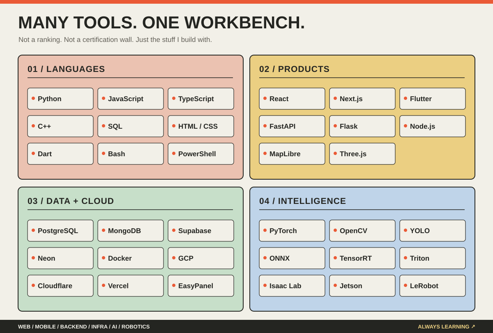
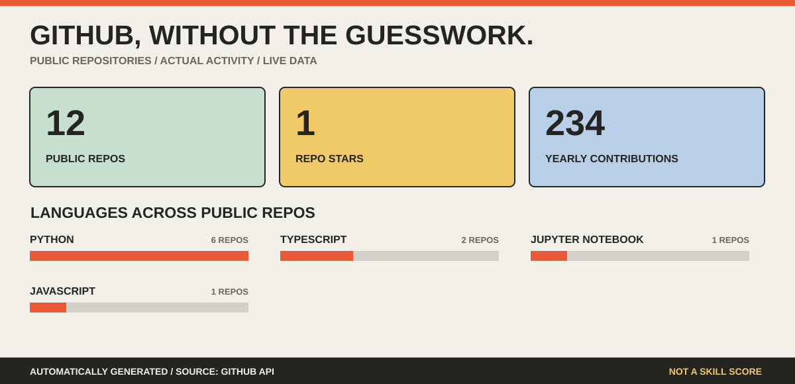
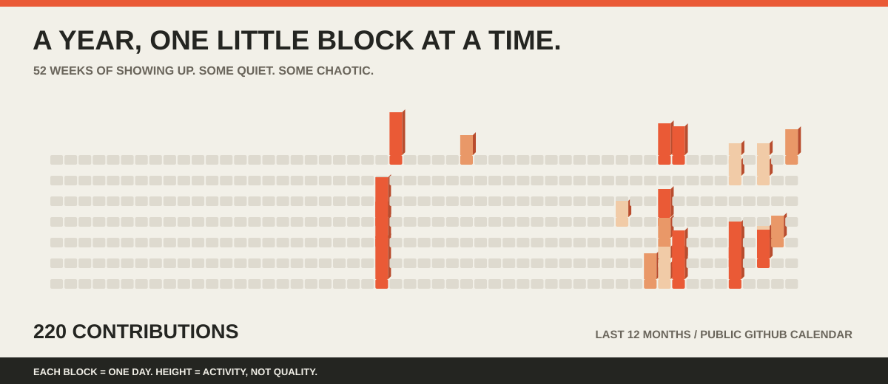

  

  **[Projects](#things-ive-shipped)** &nbsp; · &nbsp; **[Tech stack](#the-toolbox)** &nbsp; · &nbsp; **[GitHub activity](#the-receipts)** &nbsp; · &nbsp; **[Get in touch](#say-hello)**

I like building the **whole thing**: the interface people use, the API behind it, the database that remembers, the infrastructure that keeps it alive, and sometimes the AI or robot making it interesting.

**Full-stack developer. Problem collector. Occasional hardware troublemaker.**

> Give me a problem. I'll probably build something.

## 01 / Things I've shipped (and things I'm still building)

*Six different problems. Six very different rabbit holes.*

| | The problem | The build |
| :-- | :-- | :-- |
| **01 · [IntentLock](https://github.com/ShrE333/IntentLock)** | How do you let an AI agent spend money without giving it a blank cheque? | **Fintech · Payments · Security** — intent-based authorization, spending limits, approvals and audit trails. |
| **02 · [Yojana Pilot](https://github.com/ShrE333/Yojana-Pilot)** | Government schemes are complicated. What if applying felt more like a conversation? | **Full-stack · AI Agents** — conversational scheme discovery, eligibility reasoning and multilingual interfaces. |
| **03 · [TracePilot](https://github.com/Omimore/cloud-based-anomoly-detection)** | Microservices fail in ways that are hard to see. | **Cybersecurity · Observability** — anomaly detection, incident investigation and service-level monitoring. |
| **04 · [GeoSathi / Fusion](https://github.com/ShrE333/Fusion_2026)** | What if reporting a broken road were as easy as sending a photo? | **Maps · Computer Vision · Messaging** — location-aware civic reporting with vision-assisted analysis. |
| **05 · Falconex AI** | Industrial vision shouldn't require stitching together ten separate tools. | **Platform Engineering · Edge AI** — model training, inference orchestration, multi-camera pipelines and PLC integration. *Private project.* |
| **06 · Robotics Lab** | Teaching a robot isn't just collecting demonstrations. The data has to make sense. | **Robotics · Simulation · Learning** — Isaac Sim/Lab, manipulation and imitation-learning workflows. *Selected experiments.* |

Not everything is open source. Private/client work is described at a high level, without pretending there is public code.

## 02 / The toolbox

**A big stack is useful only if you know when *not* to use it.** These are languages, frameworks and platforms I've worked with across different projects—not a claim that every one is an expert-level specialty.

**Full inventory, grouped by what I actually use it for:**

| What I'm doing | What I reach for |
| :-- | :-- |
| **Languages & formats** | Python · JavaScript · TypeScript · C++ · SQL · HTML · CSS · Dart · Bash · PowerShell |
| **Web & mobile** | React · Next.js · Flutter · REST APIs · MapLibre · Three.js |
| **Backend** | FastAPI · Flask · Node.js · serverless APIs |
| **Data & authentication** | PostgreSQL · Neon · MongoDB · Supabase |
| **Infra & deployment** | Docker · Git · GitHub · GitHub Actions · GCP · Cloudflare Workers · Vercel · EasyPanel · Tailscale |
| **AI & perception** | PyTorch · OpenCV · YOLO · ONNX · TensorRT · NVIDIA Triton · LLM APIs |
| **Robotics & embedded** | NVIDIA Isaac Sim · Isaac Lab · LeRobot · NVIDIA Jetson · PLC / Modbus |

## 03 / The receipts

*Real GitHub activity, not made-up productivity scores.* These illustrations are refreshed by a GitHub Action from public repository metadata and GitHub's contribution calendar.

Public-data caveat: private activity is not included unless exposed by GitHub's contribution API. Language shares reflect public repository code, not proficiency. Chart generation source: [`scripts/generate_stats.py`](scripts/generate_stats.py).

## 04 / Say hello

I like **hard engineering problems, useful products, and strange ideas that might just work**. If you have one, let's talk.

**[Email](mailto:shdixit10@gmail.com)** &nbsp; · &nbsp; **[LinkedIn](https://www.linkedin.com/in/shriram-dixit-9470a1285/)** &nbsp; · &nbsp; **[All repositories](https://github.com/ShrE333?tab=repositories)**

Designed as a little corner of the internet. Built with Markdown, original SVG and a small Python script. No badge wall, no fake stats.
